# HEVA user guide: from annotated documents to a Data Package

This guide walks you through HEVA from start to finish: installing it, creating a project,
recording who annotated and who curates, mapping highlight colors to values, reviewing the
extracted sentences, validating the work and exporting a Data Package. It also explains what
HEVA does behind the scenes, so you can trust and describe the data it produces.

It is written for researchers, PhD and master students and anyone else who annotates documents
by highlighting them. You do not need to program. The few commands you need are shown in full.

The screenshots follow one small fictional example, a two-page "Port Aldmere heritage survey"
PDF with four highlight colors. Your screens will look the same apart from your own documents.

## Contents

1. [What HEVA does](#1-what-heva-does)
2. [Words used in this guide](#2-words-used-in-this-guide)
3. [Install and start HEVA](#3-install-and-start-heva)
4. [Prepare your annotated documents](#4-prepare-your-annotated-documents)
5. [Create or open a project](#5-create-or-open-a-project)
6. [Add people and choose the curator](#6-add-people-and-choose-the-curator)
7. [Prepare a document, step by step](#7-prepare-a-document-step-by-step)
8. [Review the extracted sentences](#8-review-the-extracted-sentences)
9. [Validate your work](#9-validate-your-work)
10. [Describe the dataset and export the Data Package](#10-describe-the-dataset-and-export-the-data-package)
11. [What is inside the Data Package](#11-what-is-inside-the-data-package)
12. [How HEVA works behind the scenes](#12-how-heva-works-behind-the-scenes)
13. [Troubleshooting](#13-troubleshooting)
14. [Command-line equivalents](#14-command-line-equivalents)

## 1. What HEVA does

Researchers often annotate documents by highlighting phrases in different colors: yellow for one
kind of value, pink for another, and so on. HEVA reads those highlights, asks you to confirm what
each color means, turns every highlighted sentence into a structured record, lets you review each
sentence, checks the result and packages it as a citable, machine-readable dataset.

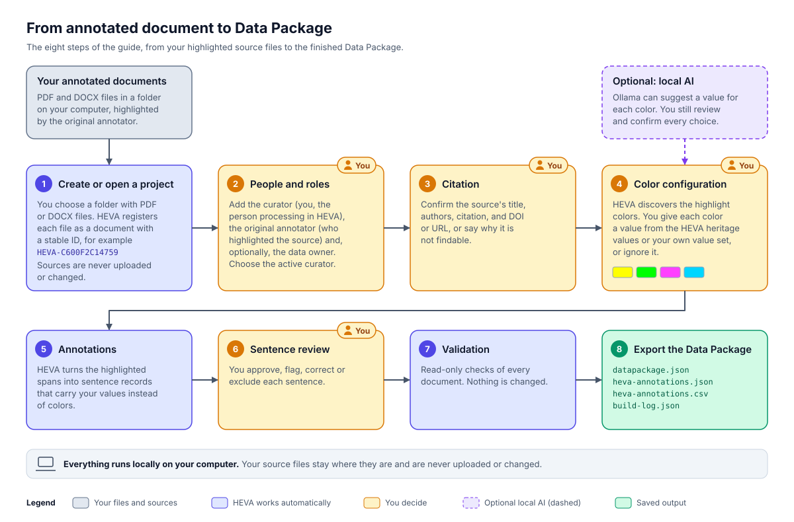

Three principles run through the whole tool:

- **Everything stays on your computer.** HEVA runs locally in your browser. It never uploads,
  copies or changes your source documents unless you explicitly import a PDF into the project.
- **People decide, HEVA records.** Colors have no fixed meaning, so a person confirms every color
  and every sentence. Automatic suggestions are only suggestions, and every decision is attributed
  to the person who made it.
- **Nothing is overwritten silently.** Palettes and value sets are versioned, re-extraction keeps
  a backup, and validation never changes your annotations or decisions.

## 2. Words used in this guide

| Term | Meaning |
|---|---|
| **Project** | A folder containing your source documents. HEVA keeps its working files in a hidden `.heva` folder inside it. |
| **Document** | One registered PDF or DOCX file. HEVA gives it a stable ID such as `HEVA-C600F2C14759`. |
| **Highlight color** | The color an annotator used to mark a phrase, recorded as a hex code such as `#FFFF00` (yellow). |
| **Value** | The meaning you assign to a color, for example `historic` or `social`. |
| **Value set** | The list of values colors can be assigned to. HEVA includes the eight **HEVA heritage values**; you can create your own, for example for a health or wellbeing study. |
| **Project palette** | A saved, versioned "color → value" mapping that can be reused across documents. |
| **Original annotator** | The person who highlighted the source document. |
| **Curator** | The person processing and reviewing the annotations in HEVA. The **active curator** is the person currently using HEVA; their name is recorded on every decision. |
| **Data owner** | The person accountable for the released dataset (optional). |
| **Sentence record** | One extracted sentence with its highlighted phrases, their values, the words (tokens) and machine-learning tags. |
| **Data Package** | The exported dataset: a small folder of JSON and CSV files plus a manifest. |

## 3. Install and start HEVA

### 3.1 Install HEVA

HEVA runs on Windows, macOS and Linux. The recommended installation uses Conda, which installs
Python and the document-reading libraries together.

1. Install [Miniforge](https://github.com/conda-forge/miniforge). On Windows, use the *Miniforge
   Prompt* for the commands below; on macOS or Linux, use a terminal.
2. Download or clone the HEVA repository and open its folder in the prompt or terminal.
3. Create and activate the environment:

   ```bash
   conda env create -f environment.yml
   conda activate heva-toolkit
   ```

4. Check the installation:

   ```bash
   python -m heva.doctor --require app --require extraction
   ```

[Install and run HEVA](INSTALLATION.md) has more detail, including how to update an existing
environment.

### 3.2 Optional: automatic color proposals with Ollama

HEVA can ask a language model to *suggest* what each color means (see
[7.3.4](#734-optional-ask-a-local-ai-model-for-suggestions)). The model runs on your own computer
through [Ollama](https://ollama.com); no text is sent to the internet. To use it:

1. Install Ollama from <https://ollama.com> and start it (open the Ollama app, or run
   `ollama serve`).
2. Download the model HEVA uses by default (about 5 GB):

   ```bash
   ollama pull llama3.1:8b
   ```

3. Check that HEVA can reach it:

   ```bash
   python -m heva.doctor --check-ollama
   ```

You can skip this section entirely; HEVA works fully without Ollama.

### 3.3 Optional: OCR for PDFs with broken text

For PDFs whose embedded text cannot be read (see [12.5](#125-ocr-assisted-extraction-for-unreadable-pdfs)),
HEVA can use the Tesseract OCR engine. The Conda environment installs it for you.

### 3.4 Start HEVA

```bash
conda activate heva-toolkit
python -m heva.app
```

Open <http://127.0.0.1:8000> in your browser. To open a project directly, add its folder:

```bash
python -m heva.app --project-root /path/to/your/project
```

To stop HEVA, click **Stop HEVA** in the review queue, or press Ctrl+C in the terminal.

## 4. Prepare your annotated documents

HEVA reads the highlights that already exist in your documents. Before you start:

- **Use one color code consistently.** Decide which color means which value, and use exactly the
  same color for the same value. Several shades may mean the same value, but one shade can never
  mean two different values.
- **PDF files:** highlights made with a PDF reader's highlight tool, colored boxes drawn behind
  text, and colored text are all detected. The PDF must contain real, selectable text; scanned
  pages without a text layer are not supported.
- **DOCX files:** Word highlight colors and colored font text in the main body are detected.
  Text in tables, headers, footers and text boxes is not read, and page numbers are approximate.
- **Black, gray and white text is ignored**, so normal text is not mistaken for an annotation.
  A shaded box behind text is a different matter: in a PDF, any filled shape except pure white
  counts as a highlight, so gray shading in a table or callout appears as a color on the color
  step. Choose **Ignore this color** for it there.
- **Put all source documents for one project in one folder** (subfolders are fine).

## 5. Create or open a project

When HEVA starts without a project, it shows the home page:

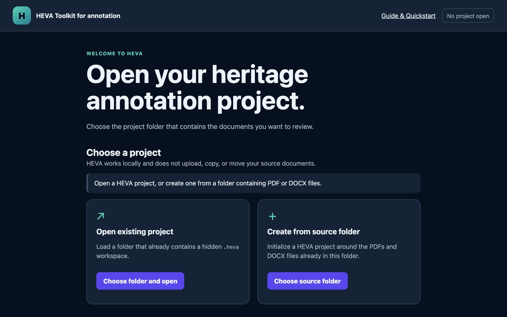

- **Create from source folder → Choose source folder.** Choose the folder that contains your PDF
  or DOCX files. HEVA registers every PDF and DOCX it finds (including in subfolders) and creates
  its working files in a hidden `.heva` folder. Your documents stay where they are.
- **Open existing project → Choose folder and open.** Choose a folder you already created a
  project in.

A folder chooser from your operating system opens. Afterwards HEVA shows the **review queue**:
the list of documents in the project and what each one still needs.

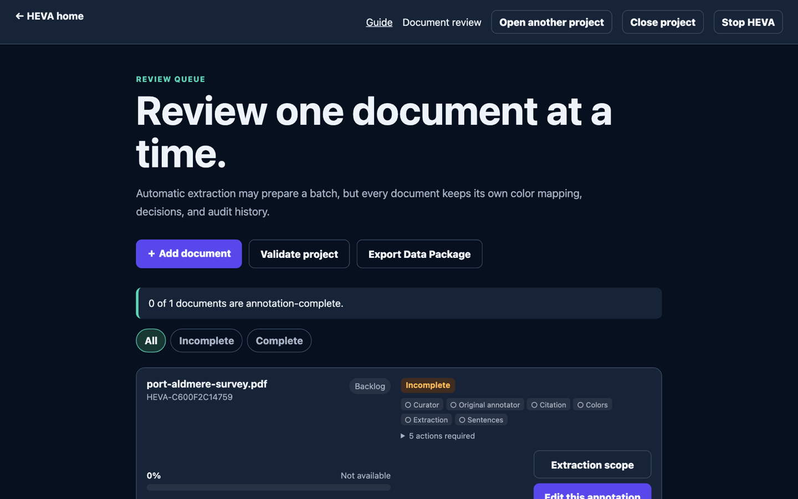

Each document card shows its readiness gates (Curator, Original annotator, Citation, Colors,
Extraction, Sentences) and a progress bar for sentence review. From here you can:

- **Edit this annotation** opens the document's preparation steps (section 7).
- **＋ Add document** adds another PDF or DOCX later (see [7.4](#74-step-4-annotations)).
- **Validate project** and **Export Data Package** check and export the project (sections 9 and 10).
- **Close project**, **Open another project** and **Stop HEVA**.

New files you place in the project folder are registered automatically the next time you open the
review queue.

## 6. Add people and choose the curator

HEVA records who did what. Before preparing documents, add the people involved. Open any document
(**Edit this annotation** in the review queue) and click **Manage people and roles** in its first
step.

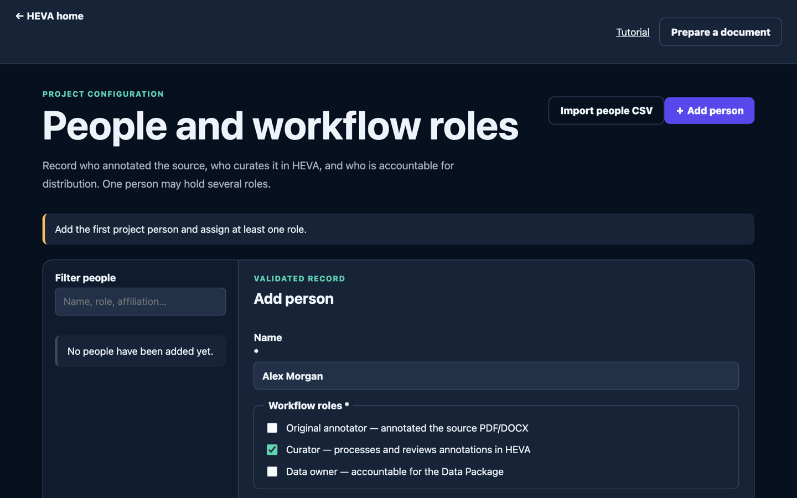

1. Click **＋ Add person**.
2. Enter the name, and optionally the affiliation, email and ORCID.
3. Tick one or more roles:
   - **Original annotator**: the person who highlighted the source PDF or DOCX.
   - **Curator**: the person processing and reviewing the annotations in HEVA.
   - **Data owner**: the person accountable for the Data Package.
4. Click **Save person**.
5. Select the curator who is using HEVA and click **Use as active curator**. Only people with the
   curator role can be the active curator.

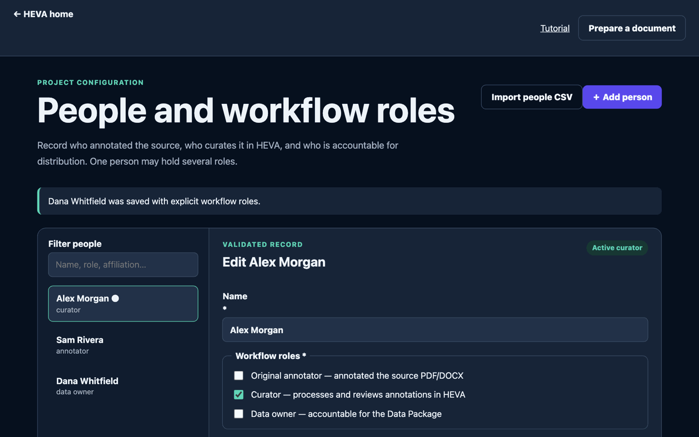

> **Why the active curator matters:** HEVA records the active curator's name on every
> confirmation and review decision. Many actions are blocked until an active curator is chosen.

Email addresses stay in the project and are never exported. To add many people at once, use
**Import people CSV** with the columns
`person_id,name,roles,affiliation,email,orcid,active_curator` (roles separated by `;`). Importing
replaces the current list of people, after every row has been checked.

## 7. Prepare a document, step by step

Click **Edit this annotation** on a document in the review queue. The preparation page has a
checklist on the left, the form in the middle and the PDF on the right. Each checklist item turns
green when that requirement is saved, and clicking an item jumps to its step:

| Checklist item | Done when |
|---|---|
| Curator | an active curator is chosen |
| Original annotator | at least one original annotator is assigned to this document |
| Citation | the citation is confirmed |
| Color config | every color has a confirmed decision |
| Annotations extracted | sentence records exist |
| Curated sentences | every sentence is approved or excluded |
| Validated document | the document passes validation |

Use **Hide PDF** / **Show PDF** to make room for the form.

### 7.1 Step 1: curator and original annotator

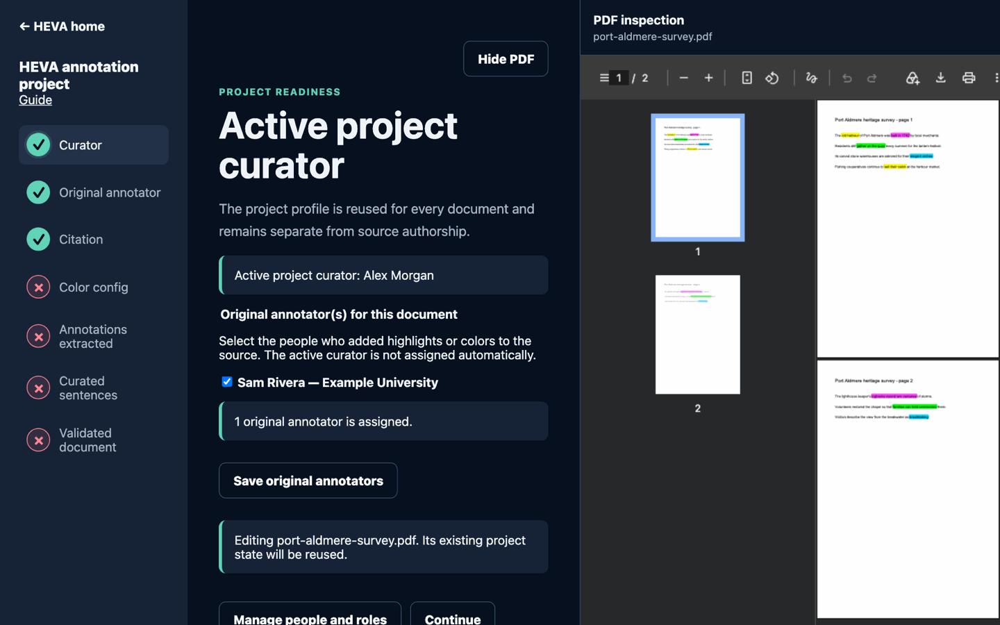

The top of the step confirms the active project curator. Below it, under **Original
annotator(s) for this document**, tick the people who highlighted this document and click
**Save original annotators**. The active curator is not assigned automatically: annotating the
source and curating it in HEVA are separate roles, even when the same person does both.

Click **Continue**.

### 7.2 Step 2: citation

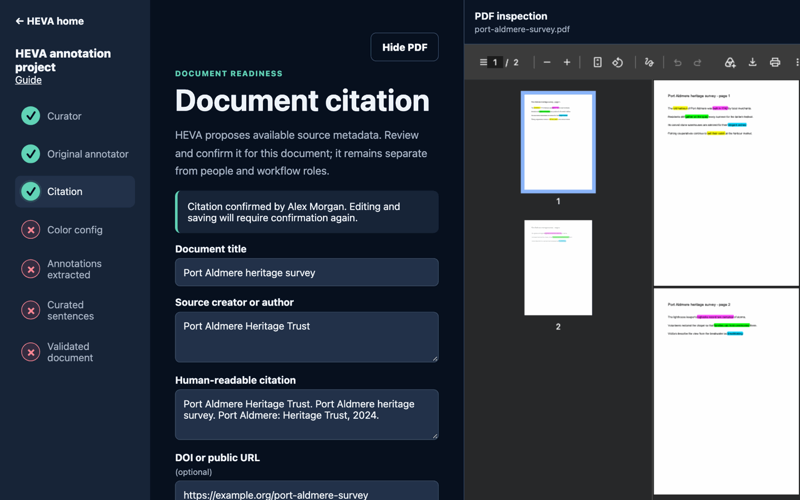

HEVA proposes a title, author and citation from the file's properties where it can. Check and
complete:

- **Document title**
- **Source creator or author**: one per line
- **Human-readable citation**: as you would cite it in a paper
- **DOI or public URL**, or, if the source is not publicly available, **explain why this source is
  not publicly findable**

Click **Save citation draft** to keep your work, then **Confirm citation details**. Saving again
after confirming withdraws the confirmation until you confirm again, so a changed citation is
always re-checked.

### 7.3 Step 3: color configuration

This step decides what each highlight color means.

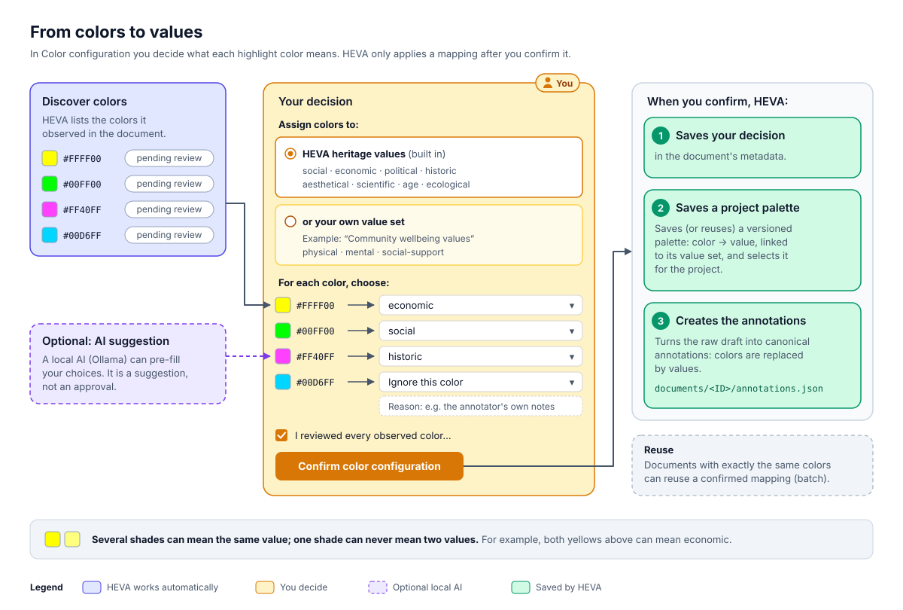

#### 7.3.1 Discover the colors

The first time you open a document, HEVA reads it and lists every highlight color it finds on
this step. (You can repeat this with **Discover colors**.) Each color starts as *pending review*:
nothing is decided yet.


Discovering the colors already reads the whole document and saves the highlighted sentences as a
**raw draft**, in which the colors have no meaning yet. That is why annotations can appear as soon
as you confirm the colors.

#### 7.3.2 Choose a value set

Under **Assign colors to**, choose which values the colors can be assigned to:

- **HEVA heritage values (built in)**: social, economic, political, historic, aesthetical,
  scientific, age and ecological. While these are selected, HEVA shows the **HEVA reference color
  code** as guidance. Your document's shades may differ slightly from it, and that is fine: the
  reference is a guide, not a rule.

  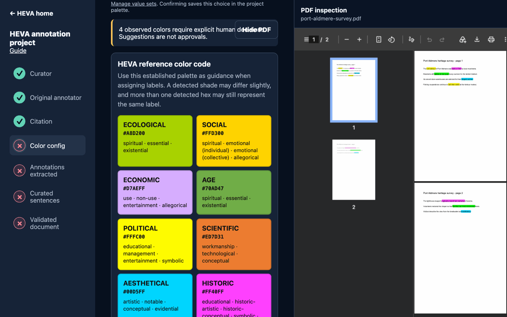

- **Your own value set**, if your study uses different values (next section).

#### 7.3.3 Use your own values (optional)

If your annotations do not use the heritage values (for example interviews about community
wellbeing, or health documents), create a value set first:

1. On the color step, click **Manage value sets**.
2. Click **＋ Create version**.
3. Enter a **Value set ID** (lowercase words joined by hyphens, for example `wellbeing-values`),
   a **Name** and an optional **Description**.
4. Add each value with **＋ Add value**: a short label in lowercase with hyphens (for example
   `mental` or `social-support`) and an optional description.
5. Click **Create immutable version**.

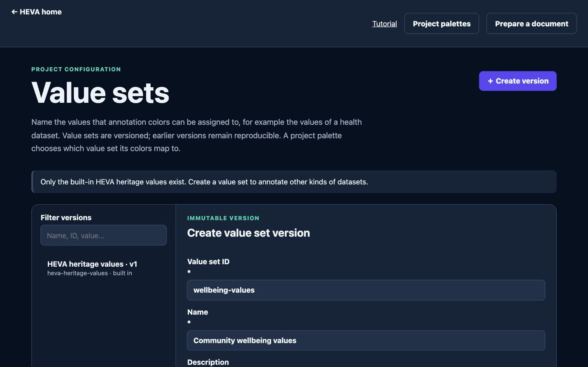

Back on the color step, choose your set under **Assign colors to**. The color choices now offer
your values, and the heritage reference is hidden:

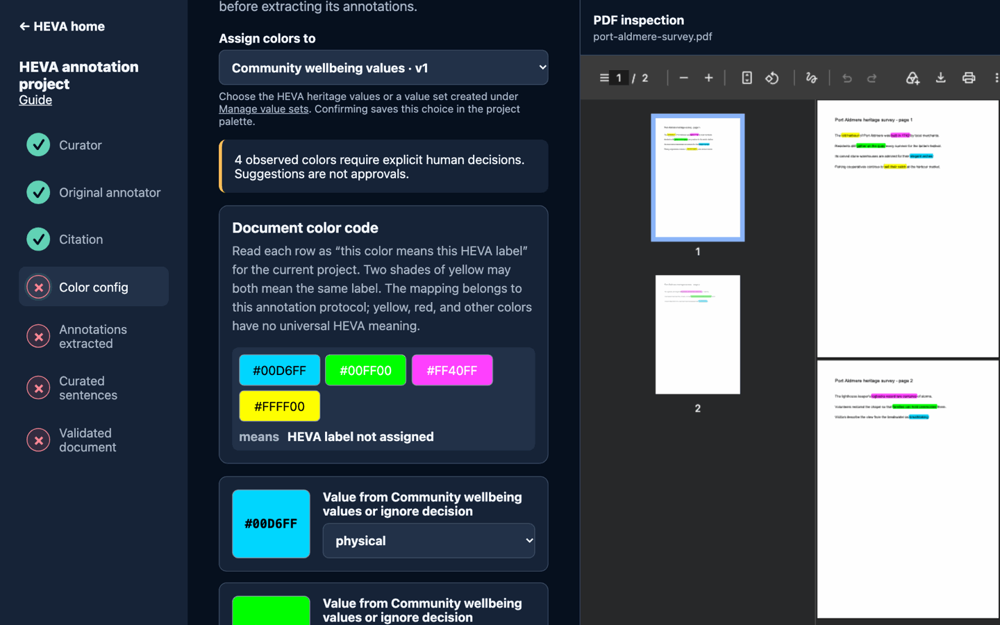

> **Value sets are versioned.** To change a value set, create a new version with the same ID.
> Earlier versions remain, so documents mapped with them stay reproducible. The heritage value set
> cannot be changed.

#### 7.3.4 Optional: ask a local AI model for suggestions

If you installed Ollama (section 3.2), click **Request automatic proposals**. HEVA sends the
sentences containing each undecided color to the model on your computer and asks which value
fits best. This takes from a few seconds to a minute.

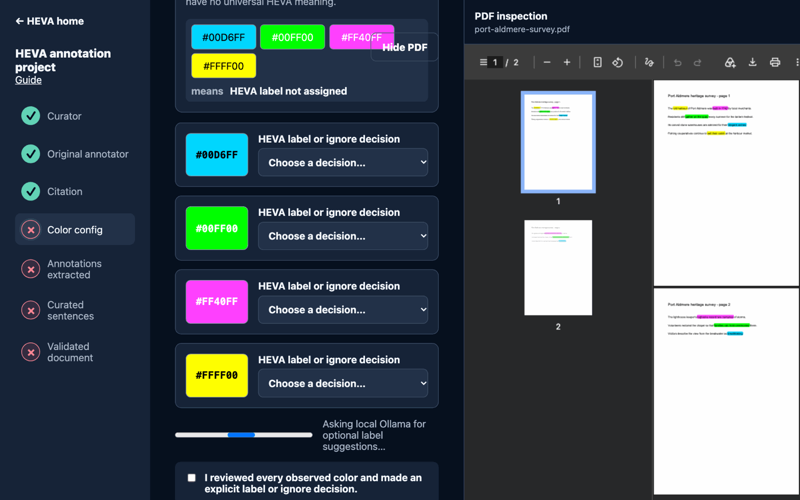

The suggestions are filled in for you, and the **Document color code** summarizes them:

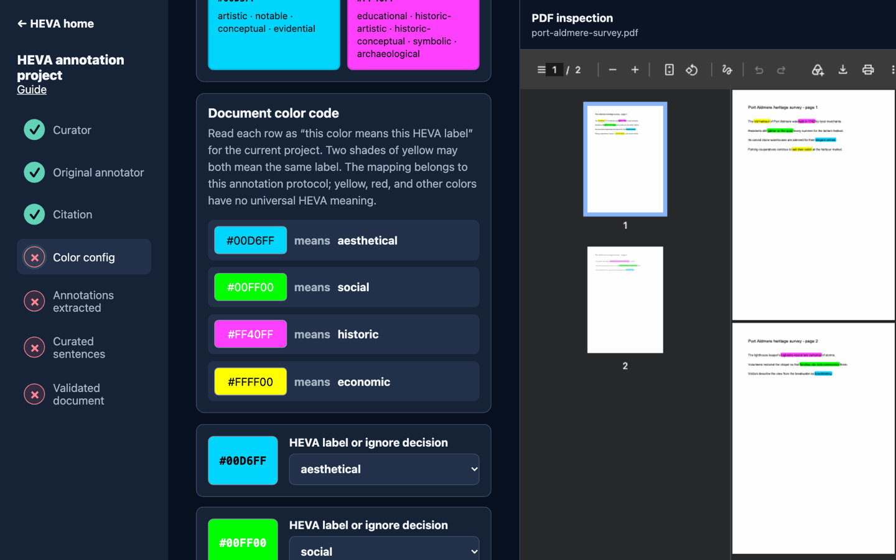

> **Suggestions are not approvals.** Read every suggestion and change any you disagree with. Only
> your confirmation in the next step counts.

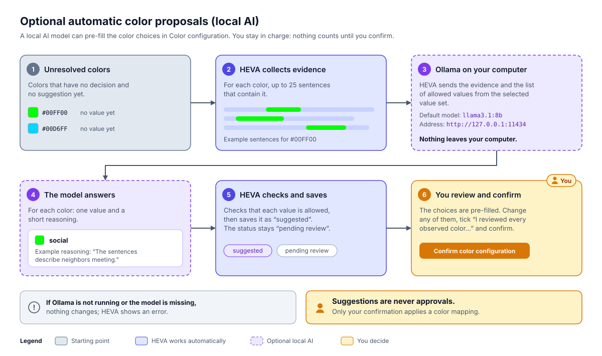

The model chooses from the value set of the project's currently selected palette. If you start a
project with your own value set, confirm one document by hand first; later documents then get
suggestions from your values.

#### 7.3.5 Decide every color and confirm

For each color, choose a value in its **HEVA label or ignore decision** list, or choose **Ignore
this color** and give a reason (for example, a color used for the annotator's own notes). Then:

1. Tick **I reviewed every observed color and made an explicit label or ignore decision.**
2. Click **Confirm color configuration**.

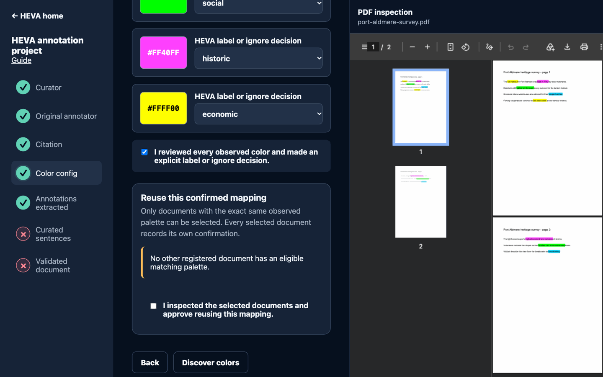

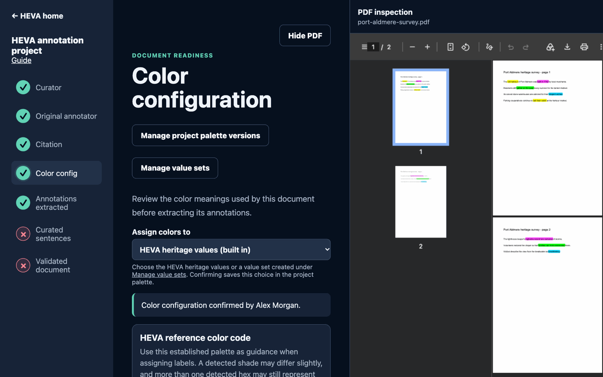

Confirming does three things:

1. It records your decisions and your name in the document.
2. It saves the mapping as a **project palette** version (or reuses an identical one) and selects
   it for the project. Other documents still need their own confirmation, but they start from the
   same value set and can reuse the mapping (below).
3. It turns the raw draft into sentence records in which each color is replaced by its value. The
   **Annotations extracted** item turns green.

> **Reuse a mapping:** below the colors, **Reuse this confirmed mapping** lists other documents
> with exactly the same colors. Tick them, tick **I inspected the selected documents and approve
> reusing this mapping.**, and click **Apply to selected documents**. Each document records its own
> confirmation.

> **Project palettes** (advanced): **Manage project palette versions** shows every saved palette
> version, its value set and which one is selected. You can also create a palette there by hand.
> Versions are never edited, only added.
>
> 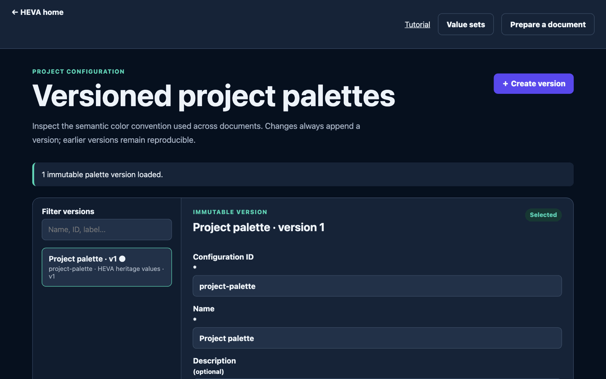

### 7.4 Step 4: annotations

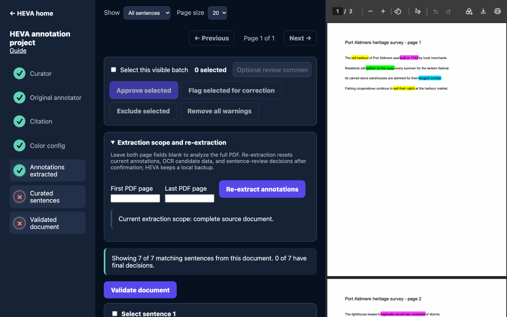

Once the document has been read, this step embeds the sentence review (section 8). Until the
colors are confirmed, it shows the raw sentences with their colors, but review decisions stay
locked. After you confirm the colors, it shows the sentence records with their values.

- **Extract annotations**: for a document that has not been read yet (for example one you just
  added), HEVA reads it, page by page for PDFs, and shows its progress. **Cancel extraction**
  stops it without losing earlier work.
- **Page scope**: to read only part of a long PDF, enter the first and last page, under **PDF page
  scope** for a new document or under **Extraction scope and re-extraction** (**First PDF page**,
  **Last PDF page**) for a document that has already been read. Leave both blank for the whole
  document.
- **Re-extract annotations** / **Rebuild extraction**: reads the document again, for example
  after changing the page scope. This resets the current annotations and review decisions, so HEVA
  asks for confirmation and keeps a backup in `.heva/documents/<ID>/extraction-history/`.
- **Build canonical annotations**: appears when a raw draft is saved and the colors are confirmed,
  but the sentence records were not built yet (for example because building failed when you
  confirmed). Click it to build them.

**Adding a new document:** in the review queue, click **＋ Add document**, then either:

- **Choose PDF (.pdf) or DOCX (.docx)**: registers a file where it is, without copying it, or
- **Import PDF into this project**: copies the PDF into the project's `sources/` folder, so the
  project is self-contained. Importing an identical PDF twice reuses the existing document.

If extraction stops with a message that the PDF text layer is not readable, see
[12.5](#125-ocr-assisted-extraction-for-unreadable-pdfs).

## 8. Review the extracted sentences

Every highlighted sentence needs a human decision before it can be exported. The review appears
inside step 4 of the preparation page. For more room, open it on its own page at
`http://127.0.0.1:8000/review/<document ID>`, for example
`http://127.0.0.1:8000/review/HEVA-C600F2C14759`.

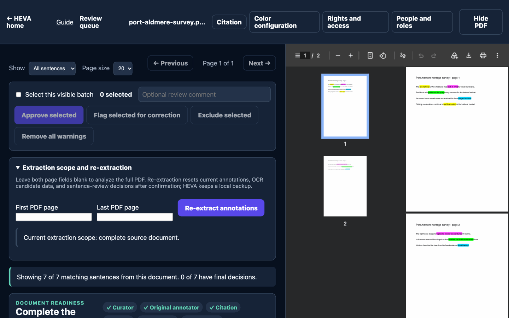

At the top you can filter (**All sentences**, **To be checked**, **Problematic**, **Checked**),
choose a page size and move between pages. Each sentence shows its highlighted phrases in their
colors. Hovering over a phrase shows its value and color.

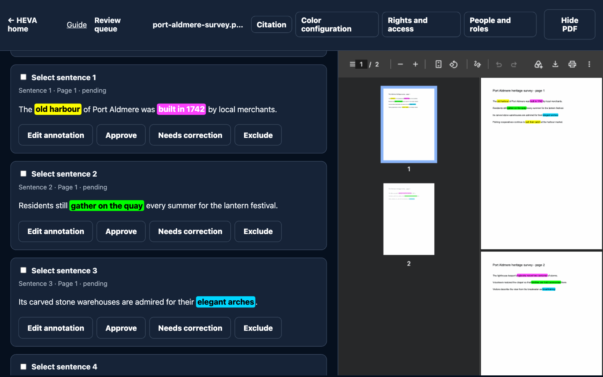

For each sentence choose:

| Button | Meaning |
|---|---|
| **Approve** | The sentence and its annotations are correct. Only approved sentences are exported. |
| **Needs correction** | Something must be fixed before approval. |
| **Exclude** | Leave this sentence out of the Data Package (for example a false extraction). |
| **Edit annotation** | Correct the sentence text or remove a wrong annotation (below). |

To decide many sentences at once, tick **Select this visible batch** (or individual sentences),
optionally add a comment, and click **Approve selected**, **Flag selected for correction** or
**Exclude selected**.

### 8.1 Correct a sentence

Click **Edit annotation** to open the editor:

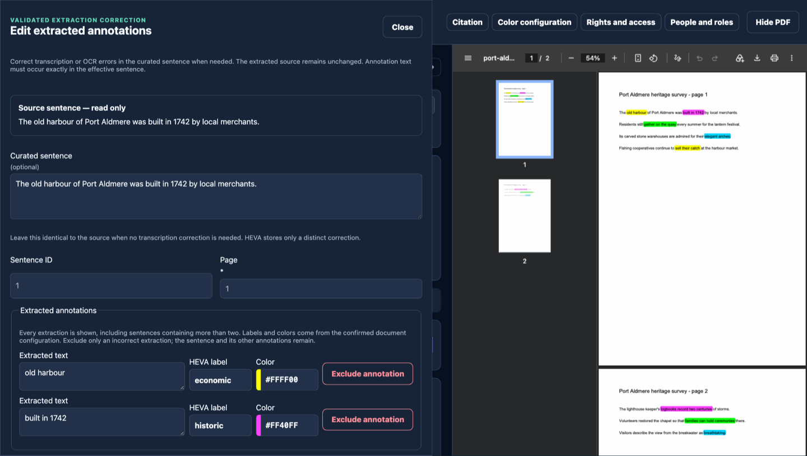

- The **Source sentence** is what HEVA extracted; it is read-only and is always kept.
- In **Curated sentence**, correct transcription errors, for example a broken word or a character
  the PDF encoded wrongly. HEVA stores the correction next to the original. Each highlighted
  phrase must still appear exactly in the corrected sentence.
- Under **Extracted annotations**, you can adjust a phrase's text or click **Exclude annotation**
  to remove a wrong annotation. The other annotations stay.

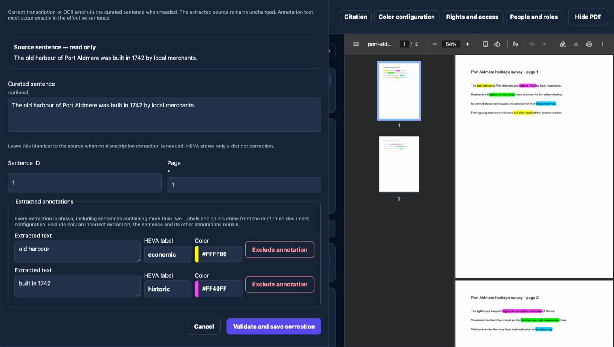

Values and colors cannot be changed here. They come from the color configuration, so that every
use of a color in a document means the same thing. To change what a color means, go back to
**Color configuration**.

Click **Validate and save correction**. HEVA checks the corrected record and marks the sentence
**Needs correction**, so you look at it once more and then approve it:

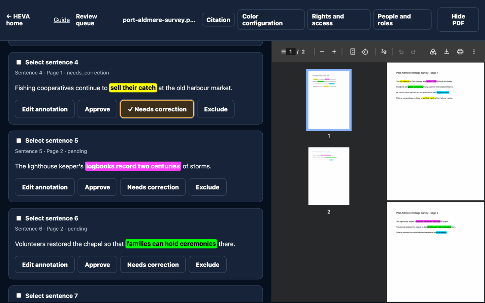

### 8.2 Warnings

HEVA flags sentences that look unusual, for example very short or very long sentences, a
sentence that does not end with punctuation, or unexpected characters. Warnings never block
export: read the sentence, then remove the warning (**Remove warning**, or **Remove all
warnings**) if it is fine. Errors cannot be dismissed and must be corrected.

### 8.3 Audit trail

HEVA keeps a history for every sentence: each decision, edit and accepted warning, who made it and
when. An earlier decision never carries over to a changed record, so nothing is approved by
accident: after a correction the sentence is marked **Needs correction**, and if its record changes
in any other way it goes back to pending. After a re-extraction, every sentence starts again as
pending.

## 9. Validate your work

Validation checks everything HEVA needs for a trustworthy Data Package. It never changes your
annotations, colors or review decisions; it only reports what is missing or inconsistent.

**One document:** on the review page, click **Validate document**. When everything is in order,
HEVA reports that the document is valid; otherwise it lists each problem, grouped by area, with a
link to the place to fix it.

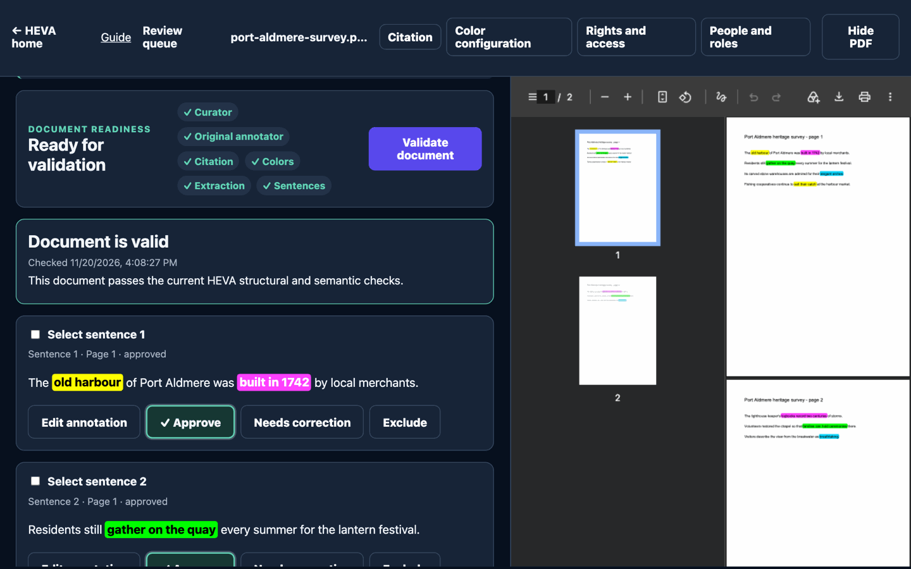

**The whole project:** in the review queue, click **Validate project**, then **Run validation**.
The page summarizes how many documents passed or failed and lists their findings. **Download JSON
report** saves the full report.

Common findings and how to fix them:

| Finding | What to do |
|---|---|
| Original annotator missing | Step 1: assign the original annotator and save. |
| Citation missing or not confirmed | Step 2: complete the citation and click **Confirm citation details**. |
| Color pending review, or color configuration not confirmed | Step 3: decide every color and confirm. |
| Sentence review incomplete | Approve or exclude every sentence (section 8). |
| Label outside the document's value set | The document's colors use values from another value set. Confirm its colors again. |
| Source changed or missing | The PDF/DOCX changed or moved after extraction. Restore it, or re-extract. |

## 10. Describe the dataset and export the Data Package

### 10.1 Describe the dataset

A Data Package needs a description of the dataset as a whole. On the validation page, click
**Dataset details**:

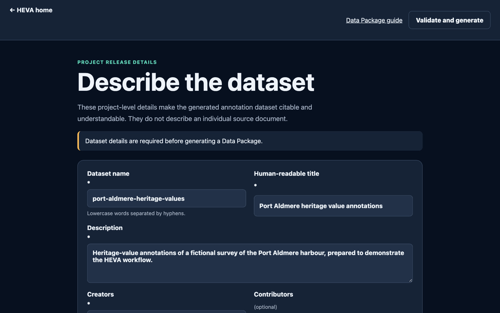

Fill in:

- **Dataset name**: lowercase words joined by hyphens, used as its identifier
- **Human-readable title** and **Description**
- **Creators**: who created the released dataset, one per line
- **Contributors** (optional)
- **License or waiver**, for example `CC-BY-4.0`
- **Rights statement**: what may be redistributed
- **Known limitations**: at least one, so future users do not over-interpret the data

Click **Save dataset details**, then **Continue to validation**.

### 10.2 Export

On the validation page, click **Run validation**. Choose which documents to include with the
**Include in Data Package** ticks (or **Select all shown**); only documents that pass validation
can be exported. Then click **Export selected Data Package**:

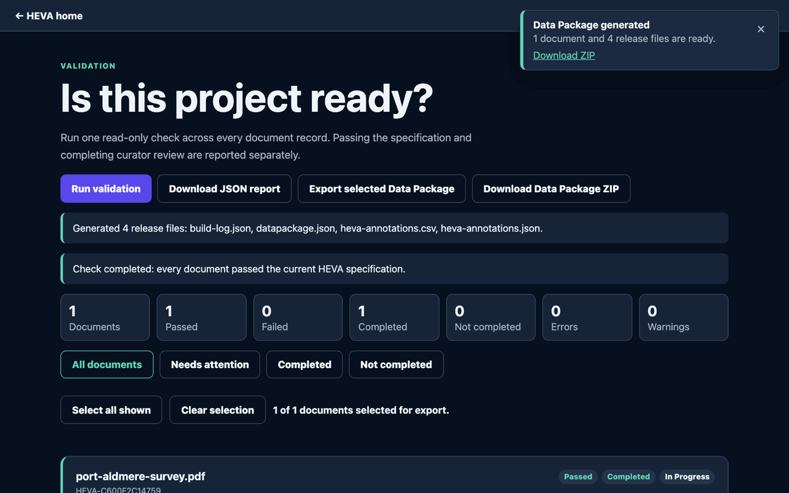

HEVA writes the files to the project's `exports/heva-data-package/` folder. **Download Data
Package ZIP** (or the link in the notification) downloads them as `heva-data-package.zip`.

Back in the review queue, completed documents show every gate in green:

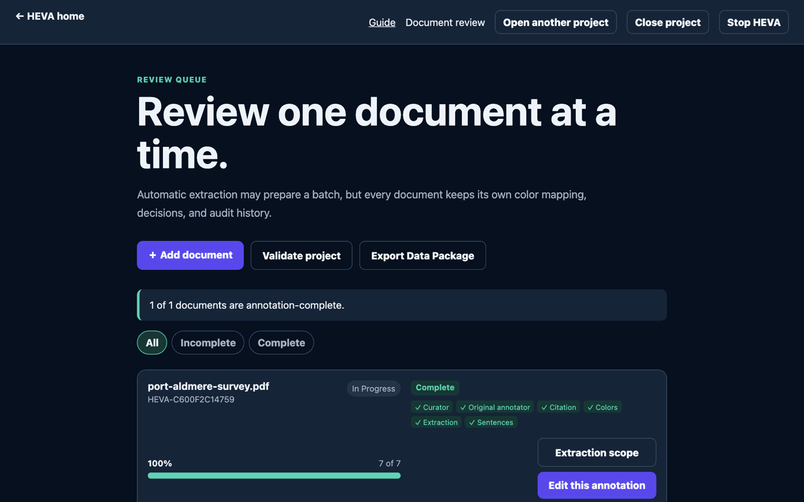

## 11. What is inside the Data Package

```text
heva-data-package/
├── datapackage.json        # the manifest: dataset description, files and value sets
├── heva-annotations.json   # the canonical data, grouped by document
├── heva-annotations.csv    # the same records as one flat table
└── build-log.json          # what was included, with checksums for reproducibility
```

**Never included:** your source PDFs and DOCX files, email addresses, rights notes, review history,
and sentences that are not approved.

### 11.1 `datapackage.json`

The manifest follows the [Frictionless Data Package](https://datapackage.org) convention. It
describes the dataset (name, title, description, license, creators and contributors), lists each
file with its size and SHA-256 checksum, and defines the **value sets** the labels come from:

```json
{
  "name": "port-aldmere-heritage-values",
  "title": "Port Aldmere heritage value annotations",
  "licenses": [{"name": "CC-BY-4.0"}],
  "resources": [
    {"name": "heva-annotations-json", "path": "heva-annotations.json",
     "mediatype": "application/json", "bytes": 11562, "hash": "sha256:a06c8f…"}
  ],
  "value_sets": [
    {"value_set_id": "heva-heritage-values", "version": 1,
     "name": "HEVA heritage values", "built_in": true,
     "values": [{"label": "aesthetical", "description": null}, "…"]}
  ]
}
```

### 11.2 `heva-annotations.json`

The main file has the dataset description, the value sets, the list of included documents and,
for each document:

- its ID, source checksum and annotations checksum;
- its citation, source authors and DOI/URL (or why it is not findable);
- its original annotators (name, affiliation, ORCID; no email);
- the value set its labels come from;
- its approved sentence records.

Each sentence record looks like this (the example has a curated correction):

```json
{
  "sentence_id": 4,
  "page": 1,
  "sentence": "Fishing cooperatives continue to sell their catch at the harbour market.",
  "curated_sentence": "Fishing cooperatives continue to sell their catch at the old harbour market.",
  "values": ["economic"],
  "entities": [
    {"start": 33, "end": 49, "text": "sell their catch", "label": "economic", "color": "#FFFF00"}
  ],
  "tokens": ["Fishing", "cooperatives", "continue", "to", "sell", "their", "catch",
             "at", "the", "old", "harbour", "market", "."],
  "ner_tags": ["O", "O", "O", "O", "B-economic", "I-economic", "I-economic",
               "O", "O", "O", "O", "O", "O"],
  "schema_version": "1.0",
  "mapping_provenance": {"method": "project_configuration", "status": "approved",
                         "config_id": "project-palette@1"}
}
```

| Field | Meaning |
|---|---|
| `sentence` | The sentence as extracted from the source. |
| `curated_sentence` | Your correction, present only when you changed the text. |
| `values` | The distinct values annotated in the sentence. |
| `entities` | Each highlighted phrase: its character positions (in the curated sentence when there is one), text, value and original color. |
| `tokens` | The words and punctuation of the sentence. |
| `ner_tags` | One tag per token in the BIO scheme used for training language models: `B-` begins a phrase, `I-` continues it, `O` is outside any phrase. |
| `mapping_provenance` | Which project palette version turned the color into the value. Present for records mapped with a project palette, which is how the app builds them. |

### 11.3 `heva-annotations.csv`

One row per approved sentence with the columns `document_id, sentence_id, page, sentence,
curated_sentence, values, tokens, entities, ner_tags, schema_version`. The list columns contain
JSON text. The CSV is convenient for spreadsheets and statistics; the JSON file remains the
canonical version.

### 11.4 `build-log.json`

Records the HEVA version, each included document with its source and annotation checksums, the
project documents that were left out, and the kinds of working files that were deliberately not
exported. With it, anyone can check that a Data Package matches the sources it was built from.

See also [What is a HEVA Data Package?](DATA_PACKAGE.md).

## 12. How HEVA works behind the scenes

### 12.1 Reading highlights

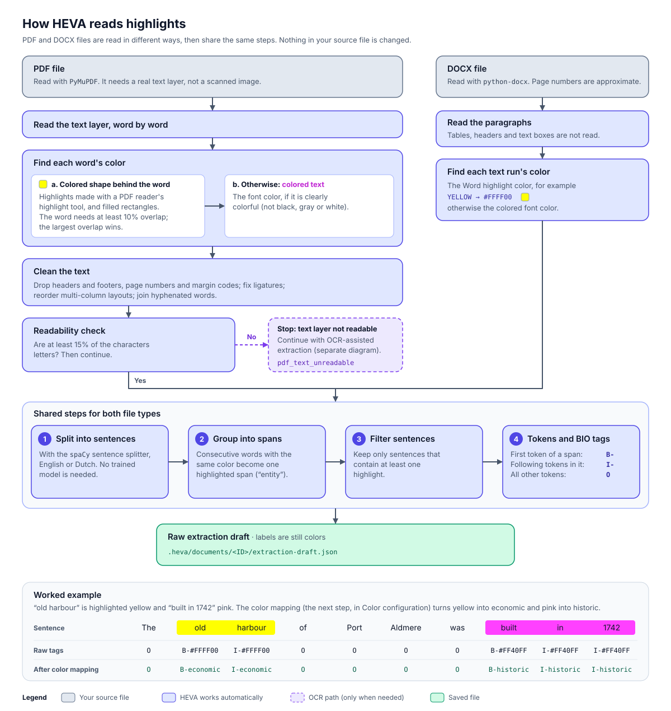

**PDF files** are read with PyMuPDF. HEVA takes the text word by word and works out each word's
color:

1. **A colored shape behind the word**: this covers highlights made with a PDF reader's
   highlight tool and colored boxes. The word must be covered by at least 10%, and the shape that
   covers it most wins.
2. Otherwise, **colored text**: the font color, if it is clearly a color (not black, gray or
   white).

HEVA also cleans the text: it removes headers, footers, page numbers and margin codes, repairs
typographic ligatures, puts multi-column pages in reading order and rejoins words hyphenated at a
line break. If a page has a substantial amount of text (at least 200 characters) but fewer than
15% of them are letters, the text layer is considered unreadable and HEVA stops instead of saving
garbled text (see 12.5).

**DOCX files** are read with python-docx. Each piece of text takes its Word highlight color (for
example YELLOW becomes `#FFFF00`) or, failing that, its colored font.

Then, for both formats:

1. **Sentences:** the text is split into sentences with spaCy's sentence splitter (English or
   Dutch, detected automatically; no language model needs to be downloaded).
2. **Highlighted phrases:** consecutive words of the same color form one phrase.
3. **Only sentences with at least one highlight are kept.**
4. **Tokens and tags:** each sentence is split into tokens, and each token is tagged `B-` (first
   token of a phrase), `I-` (inside a phrase) or `O` (outside).

The result is a **raw draft** in which every label is still a color, saved in
`.heva/documents/<ID>/extraction-draft.json`. It is not yet part of your data.

### 12.2 From colors to values

When you confirm the color configuration, HEVA replaces every color in the raw draft with its
value, using the confirmed project palette, and drops ignored colors. For the sentence "The old
harbour of Port Aldmere was built in 1742":

| Token | The | old | harbour | of | Port | Aldmere | was | built | in | 1742 |
|---|---|---|---|---|---|---|---|---|---|---|
| Raw draft | O | B-#FFFF00 | I-#FFFF00 | O | O | O | O | B-#FF40FF | I-#FF40FF | I-#FF40FF |
| After mapping | O | B-economic | I-economic | O | O | O | O | B-historic | I-historic | I-historic |

Every record is then checked against the HEVA record rules (offsets, tags and values must agree,
and values must belong to the value set) before it is saved as `documents/<ID>/annotations.json`.

### 12.3 Palettes, value sets and versions

- A **value set** defines which values exist. The built-in HEVA heritage values are always
  available; your own value sets are stored in `.heva/value-sets.json`.
- A **project palette** maps colors to values of one value set. Every palette version is kept in
  `.heva/color-configurations.json`, and one version is selected for the project.
- Each document records the palette version it was mapped with, and each exported record names it
  in `mapping_provenance`. The Data Package lists the value sets used. Together they let anyone
  trace every label back to a human decision.

### 12.4 Automatic color proposals

The optional proposals (section 7.3.4) send, for each undecided color, up to 25 sentences that
contain it to Ollama on your computer (`http://127.0.0.1:11434`, model `llama3.1:8b`), together
with the list of allowed values. The model answers with one value and a short reason per color.
HEVA checks that each answer is an allowed value and stores it as a *suggestion*; the color stays
*pending review* until you confirm. If Ollama is not running or the model is missing, nothing
changes and HEVA shows an error.

### 12.5 OCR-assisted extraction for unreadable PDFs

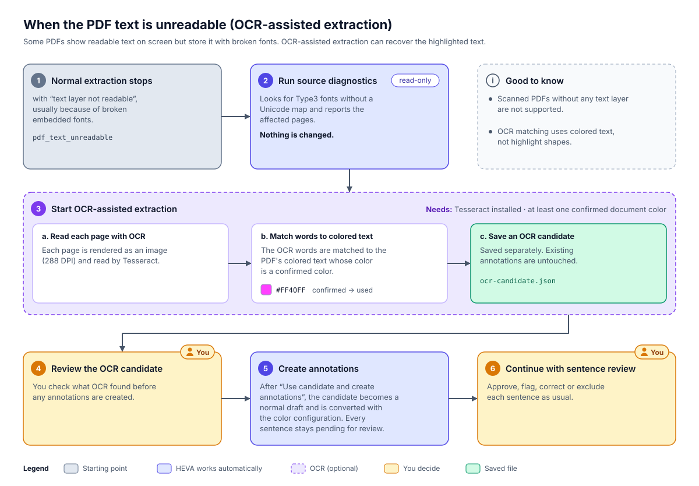

Some PDFs embed fonts without a proper character map, so their text comes out as nonsense. HEVA
detects this and stops extraction with a message that the PDF text layer is not readable. Then:

1. Click **Run source diagnostics**. HEVA checks, read-only, for fonts without a character map and
   lists the affected pages.
2. If OCR is recommended, click **Start OCR-assisted extraction**. HEVA renders each page as an
   image, reads it with Tesseract and matches the recognized words to the PDF's colored text whose
   colors you have confirmed. The result is saved separately as an **OCR candidate**; your
   existing annotations are not touched.
3. Review the candidate under **Review OCR candidate**, then click **Use candidate and create
   annotations**. Every sentence starts as pending, so review each one carefully (section 8).

Limitations: OCR matching uses colored *text*, not highlight shapes, and needs at least one
confirmed document color. Scanned PDFs with no text layer at all are not supported.

### 12.6 Where HEVA keeps its files

```text
your-project/
├── your documents (.pdf, .docx)           # never changed by HEVA
├── sources/                               # PDFs imported with "Import PDF into this project"
├── documents/<ID>/
│   ├── metadata.json                      # citation, annotators, colors, process
│   └── annotations.json                   # the sentence records
├── dataset-metadata.json                  # the dataset description (section 10.1)
├── exports/heva-data-package/             # the exported Data Package
└── .heva/                                 # HEVA's working files (hidden)
    ├── project.json                       # the registered documents
    ├── people.json                        # people and the active curator
    ├── color-configurations.json          # project palette versions
    ├── value-sets.json                    # your value sets
    └── documents/<ID>/                    # drafts, review decisions, OCR candidates, backups
```

Back up the whole project folder, including the hidden `.heva` folder. Do not edit these files by
hand; use HEVA, and run validation if you suspect a problem.

## 13. Troubleshooting

| Message or symptom | What it means and what to do |
|---|---|
| "No PDF or DOCX source documents were found in this folder." | Choose the folder that contains your documents. |
| "Select an active curator…" | Add a person with the curator role and click **Use as active curator** (section 6). |
| "No colored annotations were found…" | The document has no highlights HEVA can read, or it is a scanned PDF without text. Check section 4. |
| "The PDF text layer … is not readable enough…" | The PDF's fonts are broken. Re-export the PDF with searchable text, or use OCR-assisted extraction (12.5). |
| "Color discovery is not fully installed." / "The extraction service is not fully installed." | Install HEVA with its extraction libraries (section 3.1) and restart it. |
| "Ollama is not reachable…" | Start Ollama and download the model (section 3.2), or decide the colors by hand. |
| "Ollama proposed a label outside…" | The model answered with a value that is not allowed. Try again or decide by hand. |
| "The selected color configuration does not resolve: #…" | The document has a color the selected palette does not define. Decide every color on the color step and confirm. |
| "Annotation label and color are read-only…" | Values come from the color configuration. Change them on the color step. |
| "Cannot build a citable release without valid dataset-metadata.json" | Complete **Dataset details** (section 10.1). |
| "Document … failed validation: …" | Only valid documents can be exported. Fix the findings (section 9) or leave the document out. |
| A new file does not appear | Open the review queue again; HEVA registers new files when it loads. |

[Limitations and extraction troubleshooting](LIMITATIONS_AND_TROUBLESHOOTING.md) covers more cases.

## 14. Command-line equivalents

Everything above can be done in the browser. For automation, the same checks are available from
a terminal (with the `heva-toolkit` environment active):

```bash
# Validate a project (exit code 0 = valid, 1 = invalid)
python -m heva.curation.package_validator /path/to/project validate

# Validate one document and save the JSON report
python -m heva.curation.package_validator /path/to/project validate --document-id HEVA-C600F2C14759 --report report.json

# Build the Data Package (all documents, or repeat --document-id to select)
python -m heva.curation.package_validator /path/to/project release

# Read highlights from a file without a project, for inspection
# (writes document_extracted.json next to the file; use -o or --output-dir to choose)
python -m heva.extraction.extract_highlights path/to/document.pdf --pages 1-10
```

Next: [What is a HEVA Data Package?](DATA_PACKAGE.md) · [HEVA and validation](HEVA_AND_VALIDATION.md)
· [Software design](SOFTWARE_DESIGN.md)
